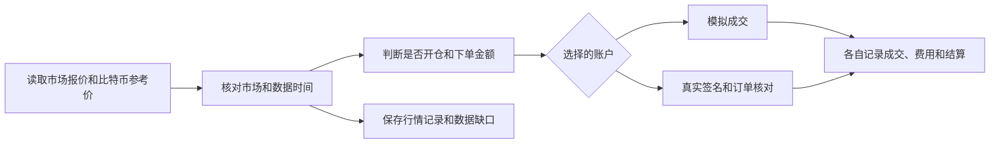

# BTC5M Standalone

BTC5M Standalone 是一个 Windows 应用，用于观察和模拟 Polymarket 的比特币 5 分钟涨跌市场。每个市场围绕一段五分钟内的比特币价格变化结算。控制台展示当前报价、策略为什么交易或等待，以及成交、费用和结算如何进入账本。

模拟账户使用虚拟资金，行情来自实时市场。程序在后台运行，关闭控制台网页后仍可继续采集和记账。当前发行版为 **v1.0.6**。首次启动时，模拟余额为零，自动策略停止，真实交易关闭。

## 快速开始

1. 在 GitHub 仓库的 Releases 页面打开 v1.0.6，在 Assets 中下载 `BTC5M-Standalone-v1.0.6-utf8.zip`。在 64 位 Windows（x64）上将整个压缩包解压到可写目录。便携包已包含 Node.js 24.19.0 和运行依赖。
2. 双击 `启动.cmd` 或 `Start.cmd`。控制台默认地址为 <http://127.0.0.1:18890/>，端口可以在 `config/app.json` 中修改。
3. 在「账户与收益」添加模拟资金，再启动模拟策略。控制台会显示当前市场、报价是否及时，以及策略等待或开仓的原因。
4. 用 `Status.cmd` 查看程序状态，用 `Stop.cmd` 停止后台。`Backup.cmd` 和 `Restore.cmd` 分别用于备份和恢复账户数据。

下载后可用 PowerShell 核对 ZIP 的 SHA-256 校验值。

```powershell
Get-FileHash -Algorithm SHA256 -LiteralPath '.\BTC5M-Standalone-v1.0.6-utf8.zip'
```

发行 ZIP 的 SHA-256 为 `f30e272a42b4aa34a6dc84de501812954db8b900bf6e261efe71a6b52ab0f868`。

## 策略如何工作

盘口显示买卖双方愿意成交的价格和数量。TWAP 是时间加权平均价格。本项目使用 60 秒 TWAP 来观察比特币参考价的变化。

当前策略在每轮最后两分钟检查 TWAP 与开盘基准的偏离。偏离需要达到对应时段的门槛，合约报价也要在允许范围内。行情过期时，策略等待新数据。每轮最多开仓一次，自动下单金额以账户净值的 2.5% 为基线，规则允许范围为 2.5%–10%。



程序分别保存行情的原始时间、程序收到行情的时间和数据缺口，便于复盘当时的判断。 [数据来源与记录口径](docs/DATA-SOURCES.md)

## 运行历程

2026 年 9 月，项目开始用实时行情运行自动模拟。10 月 17 日，主策略切换为 Ray，后台改由 Windows 独立托管。11 月迁移至便携版，原模拟账户和账本随之迁移。原运行实例于 11 月 8 日正常停机并归档。以下日期采用香港时间。

| 主策略 | 如何决定交易 | 已核对的模拟结果 |
| --- | --- | --- |
| 早期盘口动量（`forward-momentum-v1`） | 根据同一方向合约过去 30 秒的报价涨幅筛选入场，计算时扣除买入再卖出的成本，并留出缓冲。后期在市场走势反转时尝试退出，剩余仓位等待核实结算。 | 截至 10 月 16 日，旧策略实验完成 **2,929 笔**自动模拟交易，扣费后净亏 **98.33 美元**，其中记录的费用为 110.77 美元。 |
| Ray 尾盘 TWAP | 在最后两分钟比较比特币的 60 秒 TWAP 和开盘基准，再根据分时段门槛及合约报价选择是否入场。后续版本统一了开盘基准，实行每轮一次开仓，并持有至核实结算。 | 截至 11 月 8 日停机，归档主会话中 Ray 各版本共完成 **136 笔**自动模拟交易，113 笔盈利（83.09%），扣费后净亏 **78.78 美元**。其中末版 v8 完成 **94 笔**，79 笔盈利（84.04%），扣费后净亏 **6.73 美元**。 |

两组结果按各自的账本、规则和统计截点汇总。手动成交、历史回测和仅观察信号的候选策略分别记录。11 月 5 日异常重启后有一段记录无法核实，归档保留了这一标记。停机时真实交易关闭，真实订单为零。

## 真实交易（可选）

「我的钱包」可通过公开地址查看 Polygon 网络上的 pUSD 余额。真实交易使用已有 Polymarket 账户，完成账户核验后可选择通过浏览器钱包逐次签名，或使用保存在电脑上的加密凭据。

切换到真实账户需要确认完整的钱包地址。系统先暂停模拟开仓，再检查余额、交易授权、持仓和挂单。切回模拟账户时，程序停止发起新的真实交易和签名请求，并继续核对已提交的订单。两套账户分别记账，后台重启后真实交易处于关闭状态。

真实下单使用固定份额的 FAK 订单，即立即尝试成交，余量取消。每轮最多请求 100 份，并检查含费预算。程序核对实际成交、费用和兑付后入账，记录有冲突时暂停并等待核对。

## 源码与归档

| 位置 | 内容 |
| --- | --- |
| [app/start.mjs](app/start.mjs) | 程序启动入口 |
| [app/lab/](app/lab/) | 行情、策略、模拟交易、研究和控制台 |
| [app/live/](app/live/) | 真实交易、签名和账本核对 |
| [app/integration/](app/integration/) | 控制台与真实账户的连接和切换 |
| [service/](service/) | Windows 后台托管、诊断、停止、备份和恢复 |
| [tools/](tools/) | 启动入口生成和旧账户迁移 |
| [resources/](resources/) | 策略资源和发行源码清单 |
| [licenses/](licenses/) | 随附的第三方许可和声明 |

完整便携包包含启动所需的程序和依赖。依赖版本可在 [app/package-lock.json](app/package-lock.json) 中查看。发行包内的 `package-manifest.json` 记录文件清单和校验值。 [源码与发行包说明](docs/RELEASE.md)

完整研究报告、策略变更、原始数据、运行日志和历史发行包保存在项目档案中。档案分别记录历史回测、实时观察、模拟成交和真实交易证据。账户、钱包凭据及私人备份由各自使用者保管。

迁移已有账户时，先停止后台，再用完整备份恢复或迁移完整应用目录。恢复后核对余额、持仓和交易记录。常规备份排除加密钱包凭据，恢复真实交易需要重新解锁并启用。

## 发布核验

v1.0.6 发布前通过 1,075 项回归测试。便携包在包含中文和空格的 Windows 路径下完成解压和启动验证，并检查了新账户初始状态、公开钱包余额查询、账户切换及后台停止流程。

公开余额、Polymarket V2 持仓和授权查询经过实际网络核验。真实账户切换、签名授权和异常恢复在隔离测试环境中验证。真实资金成交、费用和兑付以相应账户的实际记录核对。

## 总结与体会

回看这个项目，我印象最深的是，判断方向正确和赚到钱之间还有成交价格、费用和结算。早期策略在计入费用后亏损。后来的 Ray 策略在归档样本里有八成以上的交易盈利，合计仍为负。尤其在接近 85 美分买入时，赢一笔通常只赚一小段价差，输一笔却可能损失大部分成本。看策略结果时，我会把胜率、平均赚亏金额和扣费后的净额放在一起看。

另一个体会来自故障复盘。要解释程序为什么下单或等待，需要把当时看到的报价、收到报价的时间、下单和成交记录，以及最终的结算结果放在一起核对。记录中断时，保留缺口，也保留了以后继续核对的可能。

这份项目能分享的经验，是把每次策略调整留成一条可以追查的记录。条件改了什么、结果从哪一段数据得出、还有哪些地方未知，都随版本留下来。读者可以从模拟账户开始，观察一轮市场如何从报价走到账本，再根据自己的记录判断策略表现。
