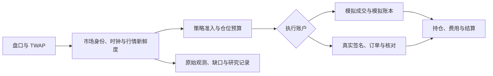

# BTC5M Standalone

面向 Polymarket BTC 5 分钟 Up/Down 市场的 Windows 本地工作台。项目在同一控制台提供行情采集、策略观察、模拟执行、成交与结算核对，以及需要明确启用的真实交易。独立后台负责持续运行，关闭浏览器后仍可采集和记账。

当前交付为 **v1.0.6**。新安装的模拟余额为 0，策略停止，真实交易关闭。

## 快速开始

1. 获取 `BTC5M-Standalone-v1.0.6.zip`，解压整个 `BTC5M-Standalone` 目录到 Windows x64 本机可写位置。发行包附带 Node.js 24.19.0、后台启动程序和锁定版本的依赖。
2. 双击 `Start.cmd` 或 `启动.cmd`。发行包默认控制台地址为 <http://127.0.0.1:18890/>，实际端口以本机 `config/app.json` 为准。
3. 在「账户与收益」添加模拟资金，再启动模拟工作流。控制台显示市场、行情新鲜度、入场条件和阻止原因。
4. 使用 `Status.cmd` 查看本安装状态，使用 `Stop.cmd` 停止整个后台。`Backup.cmd` 和 `Restore.cmd` 用于生成及恢复经清单核验的备份。

便携包完整性可用 PowerShell 核对。

```powershell
Get-FileHash -Algorithm SHA256 -LiteralPath '.\BTC5M-Standalone-v1.0.6.zip'
```

v1.0.6 ZIP 的 SHA-256 为 `d5280da369bc38090367016288cb2eaaf75d5d871927c00100419d74285fd19d`。

## 策略与数据流



交付版本的策略使用每个盘口最后 120 秒、分时段 TWAP 偏离门槛、价格保护和单盘口一次开仓规则。计划仓位以账户净值的 2.5% 为基线，规则允许范围为 2.5%–10%。行情过期会阻止新的入场，源时间、接收时间与缺失区间各自记录。

## 真实交易

「我的钱包」支持通过公开地址只读查看 Polygon 上的 pUSD 现金余额。准备真实交易时，在真实账户模块连接已有 Polymarket 账户，选择浏览器钱包逐次签名或本机加密凭据，再完成账户核验。

顶栏的执行账户切换要求确认完整地址。切到真实资金时，系统先暂停模拟开仓，再检查余额、交易授权、持仓和挂单。切回模拟时，系统立即停止新的真实入场及待签名请求，已提交的订单继续核对。两套账户各自记账，后台重启后真实交易处于关闭状态。

真实路径使用固定份额 FAK 订单，每轮最多请求 100 份，并检查计划含费预算。该数量约束适用于下单请求。实际成交、费用和兑付按可核验记录入账，证据不一致时进入暂停核对状态。

## 源码与归档

| 位置 | 内容 |
| --- | --- |
| `app/start.mjs`（原件见项目档案） | 独立工作流启动入口 |
| `app/lab/`（原件见项目档案） | 行情、策略、模拟执行、研究和控制台 |
| `app/live/`（原件见项目档案） | 真实执行、签名授权与账本核对 |
| `app/integration/`（原件见项目档案） | 控制台与真实账户的连接及切换 |
| `service/`（原件见项目档案） | Windows 后台托管、诊断、停止和备份恢复 |
| `tools/`（原件见项目档案） | 启动入口生成和旧账户迁移 |
| `resources/`（原件见项目档案） | 固定策略资源和发行源码清单 |
| `licenses/`（原件见项目档案） | 随附的第三方许可和声明 |

源码用于审阅和维护。Windows 启动入口依赖完整发行目录中的运行时、后台启动程序与依赖。SDK 版本由 `app/package-lock.json`（原件见项目档案） 锁定。发行包中的 `package-manifest.json` 记录发行文件及哈希。

本地项目档案保存研究报告、策略版本与变更记录、原始数据、运行日志和历史发行包。研究记录区分历史回放、前瞻观测、模拟成交与实盘证据，也保留失败、未知和数据缺口。GitHub 公开内容适合使用清理后的源码与说明。账户目录、钱包凭据、原始日志、私人备份和机器配置属于本地档案。

移动已有账户时，先停止后台，再使用完整备份恢复或随完整应用目录迁移。旧账户迁移和备份恢复后均需重新核对账户状态。常规备份排除加密钱包凭据，真实模式须重新解锁并启用。

## 发布核验

v1.0.6 发布前通过 1,075 项回归测试。完整 ZIP 在 Windows 的含中文及空格路径中实际解压启动，并核对文件哈希、空账户默认值、公开钱包查询、模拟账户切换和正常停止。公开余额、Polymarket V2 持仓和授权查询经过实网核验。真实账户切换、签名授权及异常恢复使用隔离夹具验证。真实钱包的签名、资金成交、实际费用和兑付须用该账户的实际证据另行核验。
